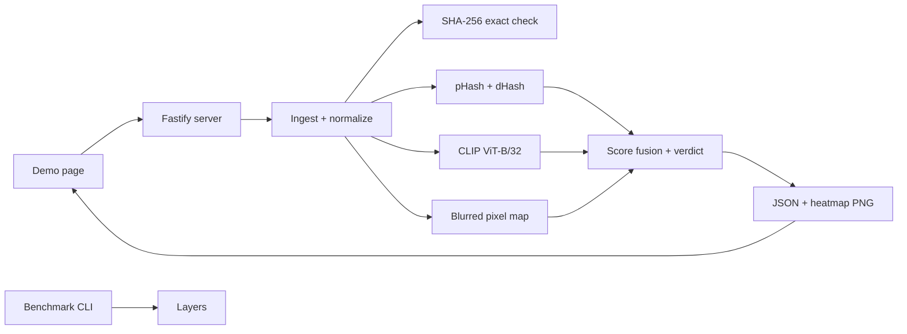

# Image Similarity API

Image Similarity API is a small, single-process TypeScript MVP for comparing an original image with a suspect, possibly edited image. It combines an exact SHA-256 check, pHash/dHash, CLIP ViT-B/32 embeddings through Transformers.js, and a blurred pixel-difference map to return one similarity score, a verdict, per-layer evidence, changed-region boxes, and a red heatmap overlay. The repository includes a plain HTML demo at the root URL and deterministic starter images so the full demo and benchmark work immediately.

## Architecture



## Requirements

- Node.js 22+
- pnpm

The project is written for Node 22 and TypeScript strict mode. The local verification environment used Node `v25.1.0`; the code stays within the Node 22 target and does not require Node 25 APIs.

## Run locally

```bash
pnpm install
pnpm dev
```

Open `http://localhost:3000/` for the demo. The first server start downloads the CLIP model assets used by Transformers.js; `/health` reports `modelReady: false` until the processor and vision model have loaded and completed their warm-up inference.

Useful commands:

```bash
pnpm run build       # compile to dist/
pnpm start           # run the compiled server
pnpm test            # run Vitest
pnpm run typecheck   # strict TypeScript check
pnpm bench           # run the 20-image benchmark
```

Set `PORT` to change the listening port:

```bash
PORT=8080 pnpm dev
```

## API contract

### `GET /health`

```json
{
  "ok": true,
  "modelReady": true
}
```

### `POST /v1/compare`

Send `multipart/form-data` with exactly two file fields:

- `source` — the original image
- `suspect` — the image to inspect

JPEG, PNG, and WebP are accepted. Each uploaded file is limited to 10 MB, and Sharp rejects images over 40 million decoded pixels. Images are EXIF-rotated, flattened onto white, converted to sRGB, stripped of metadata, and resized inside a 512-pixel long-side limit without enlargement.

Example:

```bash
curl -X POST http://localhost:3000/v1/compare \
  -F "source=@source.png" \
  -F "suspect=@suspect.png"
```

Successful response:

```json
{
  "similarity": 0.93,
  "verdict": "tampered_match",
  "layers": {
    "exact": false,
    "phashDistance": 6,
    "dhashDistance": 8,
    "hashScore": 0.89,
    "embeddingCosine": 0.91,
    "embeddingScore": 0.78,
    "pixelScore": 0.82,
    "changedFraction": 0.07
  },
  "regions": [
    { "x": 120, "y": 80, "width": 140, "height": 90 }
  ],
  "heatmapPngBase64": "...",
  "normalizedSize": { "width": 384, "height": 256 },
  "timingMs": {
    "total": 420,
    "ingest": 40,
    "hash": 15,
    "embed": 300,
    "tamper": 60
  },
  "requestId": "..."
}
```

When CLIP is not ready or an inference exceeds five seconds, the request still completes from hash and pixel evidence and includes `"degraded": true`. In that case `embeddingCosine` and `embeddingScore` are `null`. Exact byte matches return `identical` with similarity `1` before the other comparison layers run.

The verdict values are exactly:

- `identical`
- `near_duplicate`
- `tampered_match`
- `different`

All errors use this shape:

```json
{
  "error": {
    "code": "INVALID_IMAGE",
    "message": "Only JPEG, PNG, and WebP images are accepted."
  }
}
```

The supported error codes and statuses are `MISSING_FILE` (400), `FILE_TOO_LARGE` (413), `INVALID_IMAGE` (400), and `INTERNAL` (500).

## Scoring

The hand-tuned fusion configuration lives at the top of `src/layers/fuse.ts`:

- hash weight: `0.2`
- embedding weight: `0.5`
- pixel weight: `0.3`
- near-duplicate threshold: similarity `>= 0.9` and changed fraction `< 0.02`
- tampered-match threshold: similarity `>= 0.55` and at least one region

If the embedding is unavailable, its weight is redistributed proportionally across hash and pixel scores. The tamper map uses the absolute grayscale difference, which is already bounded to `0..255`, so the fixed threshold of `40` remains stable for small brightness/filter/compression changes instead of normalizing tiny global changes into a full-image mask.

## Benchmark

`pnpm bench` reads the first 20 sorted JPEG/PNG/WebP files in `bench/images`, creates eight deterministic attacks per image, creates the same number of negative pairs, tunes one threshold per method for maximum accuracy, and writes the complete computed output to `bench/results.md` and `bench/results.json`.

The committed run used the 20 deterministic starter images in this repository and 320 total pairs. Latency is machine-dependent; the table below is the output captured from that run:

| Method | Chosen threshold | Accuracy | False positive rate | Average latency (ms) |
| --- | ---: | ---: | ---: | ---: |
| full fusion | 0.919 | 84.38% | 5.00% | 89.400 |
| pHash only | 0.941 | 83.75% | 0.00% | 18.405 |
| pixel difference only | 0.987 | 85.31% | 5.00% | 18.099 |

These numbers are a reproducible MVP benchmark, not a claim of production accuracy. Replace the starter inputs with the intended dataset before using the results in a presentation.

## Known limits

- Crops and rotations are not geometrically aligned in this MVP.
- The server is single-process; there is no queue or horizontal coordination.
- The embedding cache is in memory and is lost when the process exits.
- Thresholds are starting values and should be tuned against the target dataset.
- Region coordinates use the suspect image's normalized coordinate space; the UI uses `normalizedSize` to scale them.

## Roadmap

- Queue-based async jobs
- Redis caching
- Circuit breakers and graceful degradation
- Geometric alignment with keypoints and RANSAC
- Rate limits and API keys

## Docker

Build and run the compiled server with:

```bash
docker build -t image-similarity-api .
docker run --rm -p 3000:3000 image-similarity-api
```

The image uses `PORT=3000` by default and still downloads/warm-ups the Transformers.js model on first start.
